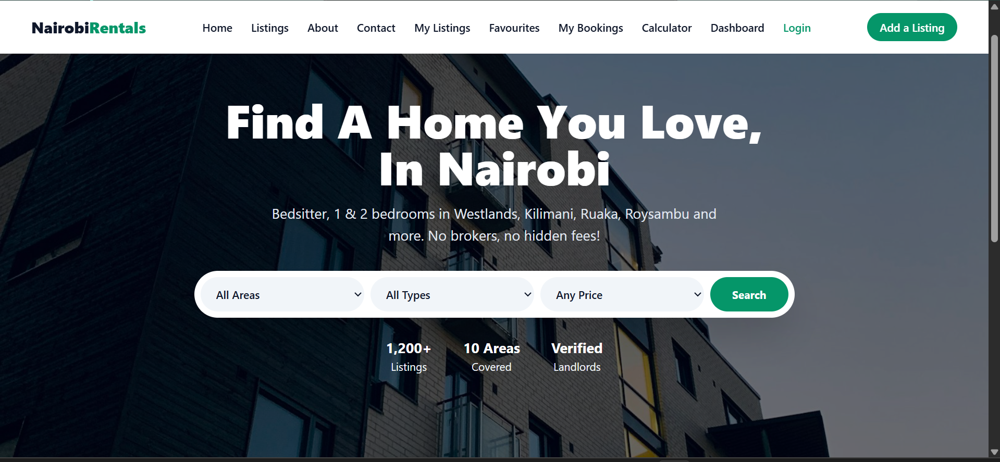
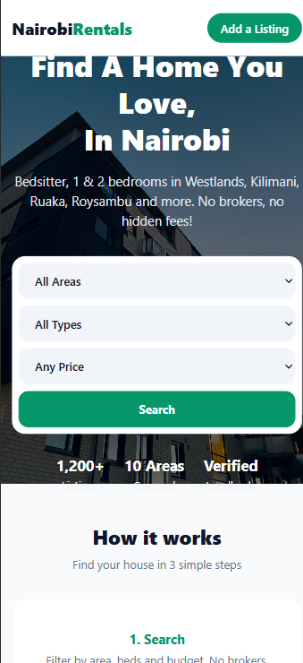

# Nairobi Rentals
**Live Demo:** https://david-mwonge123.github.io/rental_finder/
## Overview
Nairobi Rentals is a multi-page website for finding houses in Nairobi without brokers. You can be able to search, filter,save favourites, compare houses, book viewing, check if you can afford it and even list your own house. This project uses HTML, Tailwind and JavaScript, and everything is saved in the browser using localStorage.

## Project Brief
### Problem
Finding a rental house in Nairobi is stressful and unsafe:
- Agents on Facebook/WhatsApp post the same house many times with different prices.
- Fake information once you travel to view the house.
- No way to compare houses side-by-side.
- Anyone can post a fake listing with a fake phone number.

### Solution
Nairobi Rentals is a single, trusted place for rentals:
- All houses in one place with real prices, areas, and amenities
- Filter by Area, Type, and Price
- Save favourites, compare 2-3 houses, calculate affordability.
- Book a viewing without agent friction.
- Only **verified listers** can post houses.

### Target Users
1.  **Tenants / Students / Young Professionals** - Looking for Bedsitters to 3-Bedrooms in Westlands, Kilimani, Ruaka, Roysambu, Ngong, Kileleshwa, Embakasi, Umoja, Thika Road, Kasarani.
2.  **Landlords / Agents / Caretakers** - Want to list a house quickly and reach tenants.

### Project Scope
This is a **front-end only** demo built with HTML, CSS, JavaScript and `localStorage`. It simulates a real backend. In the real website, `localStorage` would be replaced with Firebase / Supabase / a Node.js API + database.

### Features
- **13 Pages:** Home page, Listings page, About page, Add listings page, Favourites page, Bookings page, Dashboard page, House details page, My listings page, Comparing houses page, Affordability calculator page, Edit my lists page, Verification page.
- **Sticky Navbar:** Same theme across all pages.
- **Listing cards:** All houses listed in grid cards.
- **Forms:** Used in contact section, verification page, add my listings page, edit my listings page.
- **Responsive:** Works on mobile and desktop.

### Technologies used
1. **HTML** - Semantic elements for all 13 pages.
2. **CSS** - Tailwind css for style throughout.
3. **JavaScript** - Functionailty in buttons, dashboard, calculator,CRUD.

### How to run 
- Clone the repo -  
```bash 
git clone https://github.com/David-Mwonge123/rental_finder
```
- Go into the project folder cd organic_living
- Open in VS Code code .
- Open with Live Server -Install Live Server extension in VS Code -Right-click index.html>Open with live server -Or just double-click index.html in file explorer.

### Desktop Respinsive

### Mobile Responsive


### Author
David Mwonge - JavaScript Capstone Project - 2026